# unsound: the manual

A broken machine you overdrive. Everything it can do, and where to find it.

Hover over almost anything (browser entries, knobs, sliders, buttons) for a reminder of what it
does, and press **?** in the window for every shortcut.

---

## 1. Starting it

1. Open `play.scd` in SuperCollider.app.
2. In the first block, set `~folder` to a folder of samples (subfolders count). If it's empty or
   missing, it uses the macOS system sounds.
3. Put the cursor in that block and press **Cmd-Return**. The window opens.
4. Press **play** (or **space**).

**Cmd-.** is panic: everything stops, the sound graph rebuilds itself, and you press play again.

The default set is two **bitmeisters** (bytebeat), **grains**, and **the wall**, with four
returns: **A** echo (overdriven), **B** space (overdriven), **C** freq shift, **D** smear.

---

## 2. The screen at a glance

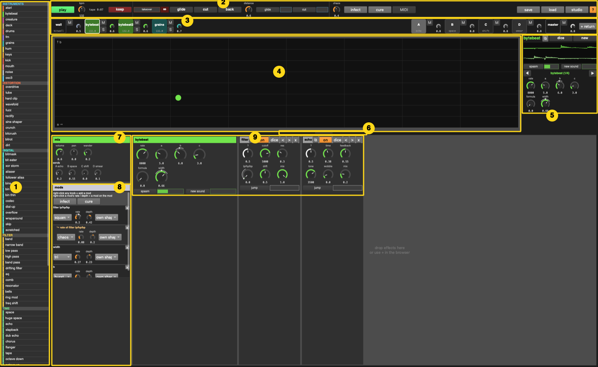

| # | what | how |
|---|---|---|
| 1 | **browser** | everything you can add. **Double-click** = add to the focused track (instruments make a new track). **Drag** onto a pad, the chain, or onto a device to insert before it. Hover for a description. |
| 2 | **top bar** | play, bpm, **●** session time, tape + **keep**, **takeover**, glide / cut / back, distance, glide/cut every so often, chaos, infect / cure, MIDI learn, save / load, **studio**, **?** |
| 3 | **pads** | one per track. Click = focus. **M** mute, **S** solo, knob = volume. Returns and master on the right, then **+ return**. |
| 4 | **screen** | the focused track's own view: XY pad, drum grid, roll, tape, the wall's recipes… |
| 5 | **focus column** | track name, **⧉** (open the track in its own window), **dice**, **new** sound, a scope, the track's every-so-often sliders, and the **8 encoders** |
| 6 | **handle** | drag it up or down to trade screen space for chain space |
| 7 | **mix** | volume, pan, wander, and a **send** knob per return (named by what's on it) |
| 8 | **mods** | every modulator on this track, as a tree. See [Modulation](#7-modulation-everything-moves-everything) |
| 9 | **chain** | the instrument's own panel, then every effect in order. Scrolls sideways. Drop effects here. |

The old Ableton-style window is still there: press **`** (backtick) or click **studio**.
See [The studio window](#14-the-studio-window).

---

## 3. Tracks and pads

- **Focus** a track: click its pad, or **1–9** (instrument tracks in order), **0** (master),
  **← / →** (previous / next).
- **Mute / solo / volume**: the **M**, **S** and knob next to each pad (solo works on the wall too). **M** on the wall fades it
  in and out instead of cutting it. Keys: **M** mutes the focused track, **↑ / ↓** volume.
- **Add an instrument**: double-click (or drag) it in the browser, under INSTRUMENTS.
- **Add a return**: **+ return** at the right end of the pads (it starts with a reverb; change it
  in its chain).
- **Remove a track**: in the studio window, the **x** at the bottom of its mixer strip.
- **Tempo per track**: every instrument can run at its own tempo. In the studio window's
  Clip/Devices header: **sync**, **own bpm**, **tempo drift**, **speed**, **resync (R)**.
  **shift ↑ / ↓** nudges the focused track's tempo (and unsyncs it).

---

## 4. The chain and its devices

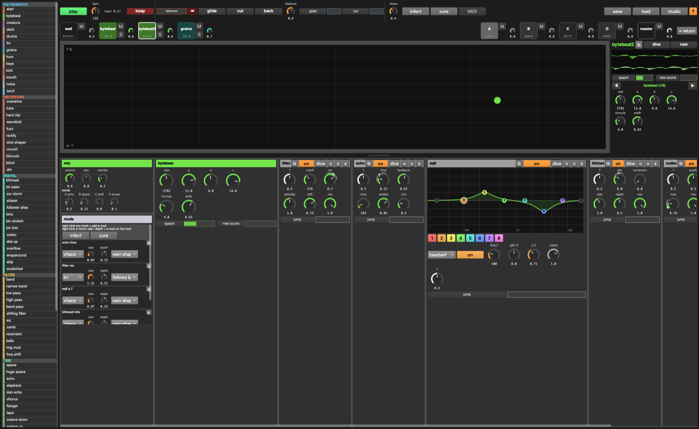

Every device box has, along its title bar:

| | |
|---|---|
| **⧉** | open this device in its own window |
| **on** | bypass |
| **dice** | random settings for this device |
| **< >** | move it left / right in the chain |
| **x** | remove it |

Inside every device:

- **?** the *mystery knob*: sweeps a hidden handful of the device's settings between two random
  points. Turning it is a quick way to find something new. (Dice re-rolls which settings it moves.)
- **jump**: every so often, throws the mystery knob somewhere new by itself (see
  [Every so often](#8-every-so-often)).

**Adding effects**: double-click in the browser (adds to the end of the focused track), or drag
onto the chain, or onto a specific device to put it *before* that device. Whole **chains** (bottom
of the browser) add several at once.

The master always ends in a **limiter** (it can't be removed). Everything before it can be as
broken as you like.

---

## 5. Pop-out windows

Click **⧉** on any device, or **⧉** next to the track name in the focus column, and it opens in
its own window, like a plugin window in a DAW. Open as many as you like and **Cmd-`** between
them. They stay open while you focus other tracks, and close themselves if their device or track
is removed.

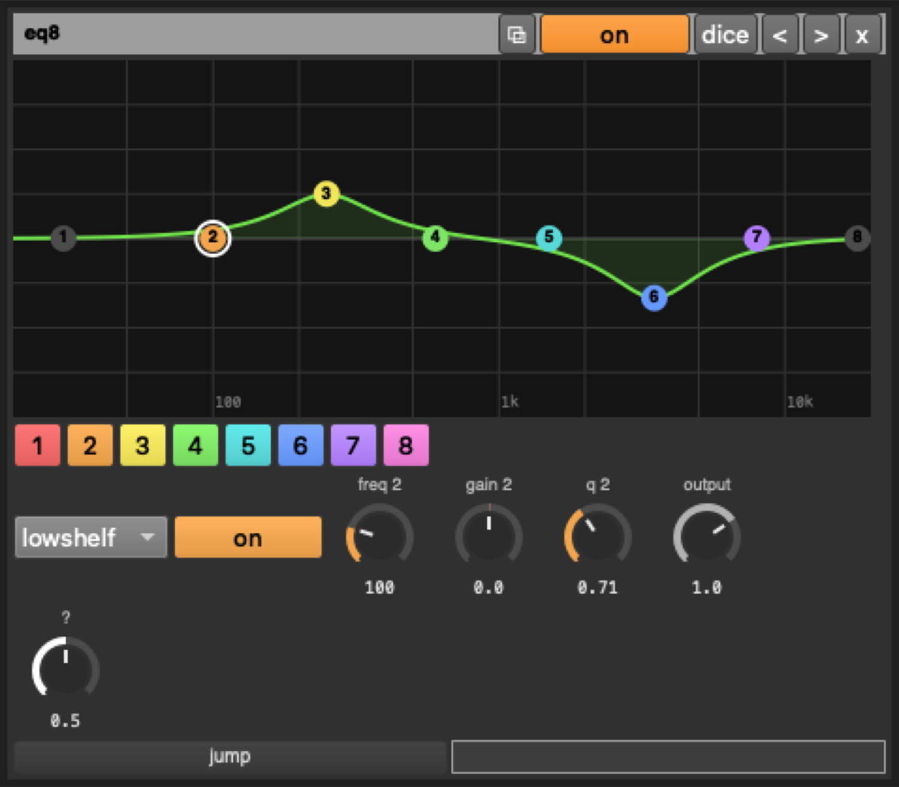

---

## 6. The machine: wall, takeover, tape

### The wall

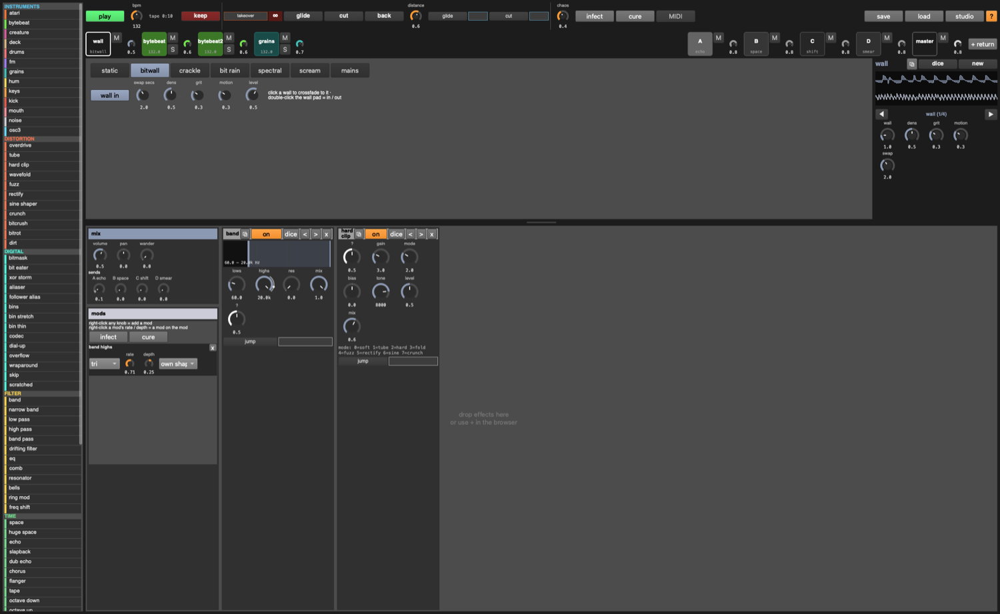

The wall is the first pad: a background noise layer to swap in and out. Focus it to see its recipes:

- **static, bitwall, crackle, bit rain, spectral, scream, mains**: click one and it **crossfades**
  to it over **swap secs**.
- **wall in** (or the wall pad's **M**): fade the whole wall in or out.
- **dens** (density / rate), **grit** (how broken), **motion** (how much it moves by itself), **level**.
- Its chain starts with **band** (shape it: lows and highs) and a hard clip. Add anything else.

Solo works on it like any track (it goes quiet when you solo something else, and it has its own
**S**). Dice and glide leave it alone: it's yours to shape.

### Takeover

In the top bar, the orange-outlined **takeover** slider and **∞**:

- **takeover** (slider): pushes the **focused track** toward infinity (driven into digital
  clipping and up in level) while every other track and the wall **duck** under it.
- **∞** (hold) or hold the **'** key: all the way, for as long as you hold it.

Takeover follows focus: click another pad and it moves there. Returns aren't ducked, so the
taken-over track's echoes still come through.

### The session, tape and keep

**Everything you play is recorded to disk**, the whole time the transport runs:
`~/Music/unsound/sessions/session-<date>-1.wav`, `-2.wav`… (24-bit, about 1 GB an hour). It starts
on the first play and pauses a few seconds after you stop (so tails are kept). Every 30 minutes it
starts a new part, overlapping the last one by two seconds, so nothing falls in between. The **●**
in the top bar shows the session's playing time; click it to open the folder.

On top of that, the last **15 minutes** are always in memory (the tape), for quick clips:

- **keep** (or **return**): save what's on the tape to `~/Music/unsound/keep-<date>.wav` (24-bit),
  and drop a marker in the session's notes (`session-<date>.txt`: which part, how far in) so you can
  find that moment in the long recording.
- **shift-return**: keep just the last minute.

So play for as long as you like without thinking about recording; nothing is lost.
(`~sessionOn = false` in `play.scd` before loading turns the session recording off.)
(The studio window also has the old **● record** button for a classic start/stop recording.)

---

## 7. Modulation: everything moves everything

**Right-click any knob** (or alt-click) to give it a **mod**: it starts moving by itself around
where you set it. Right-click again to take it away. A modulated knob shows its range as a thin
outer arc; turning it moves the center the mod swings around.

Mods live in the **mods** panel at the start of the chain:

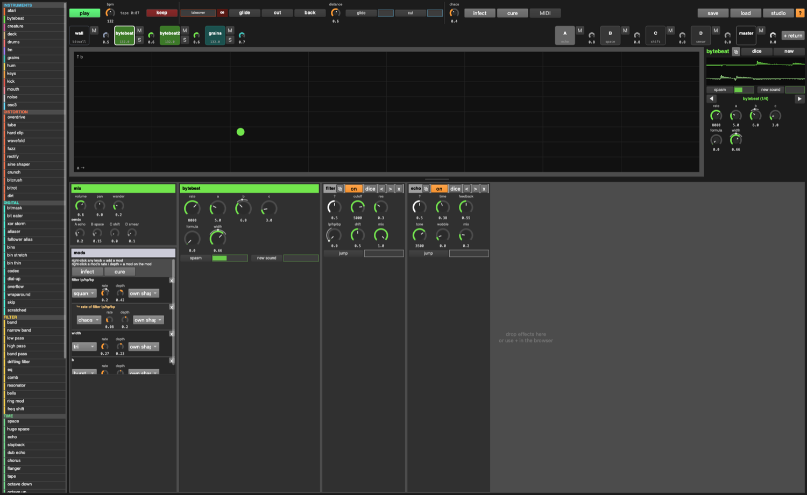

Each mod has:

- **shape**: sine, tri, square, saw, random, drunk, chaos, burst
- **rate** and **depth** (negative depth inverts it)
- **source**: *own shape*, or *follows <track>* (moves with that track's loudness: negative depth
  = ducking), or *driven by <another mod>*
- **x** removes it (and any mods on it)

**Mods into mods**: a mod's **rate** and **depth** are knobs too. Right-click one, and the mod that
moves *it* appears indented underneath ("↳ rate of …"). Keep going as deep as you like.

Also:

- **infect** (button, or **I**): scatters random mods (some following other tracks, some on other
  mods). The mods panel's own **infect** only touches the focused track.
- **cure** (or **\\**): removes every mod. The mods panel's **cure** only touches this track.
- **alive** (studio window): new tracks and devices arrive already moving.
- Anything with a knob can be modulated: device settings, instrument settings, sends, pan, the
  every-so-often sliders, takeover, tempo…
- The master is never infected. It's yours, by hand.
- The studio window's **mods** tab shows every mod in the set at once.

---

## 7½. LFOs (Serum / Vital style)

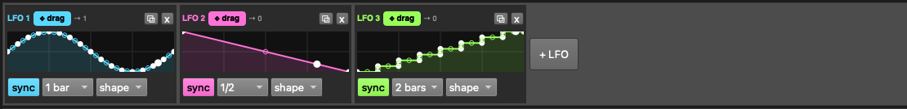

The row under the pads holds the LFOs: three to start, **+ LFO** for as many as you like.

- **Draw the shape**: drag the white points; drag the small circle halfway along a segment to bend
  it (curves); double-click to add a point, double-click a point to remove it. **shape…** loads a
  preset (sine, tri, saw up / down, square, pluck, swell, steps, random).
- **Speed**: **sync** on = locked to the tempo (1/32 to 8 bars); off = free, in Hz (the small knob).
- **Use it**: grab the coloured **✥ drag** handle and drop it on **any knob** (or every-so-often
  slider), anywhere: instruments, effects, sends, the wall, another LFO's rate. The knob gets a ring
  in the LFO's colour and a little numbered badge.
- **How much**: drag that knob's **outer ring** up or down (or **cmd-drag** the knob). Drag below
  zero to invert it. Turning the knob normally still moves the centre it swings around.
- The **→ n** next to the handle counts what the LFO is moving. Each of those also shows in the
  track's **mods** panel with source "LFO n", where you can switch it to another LFO or another source.
- **⧉** opens a big editor for the shape; **x** removes the LFO (and the mods it was driving).
- An LFO's free rate is a knob too: drop another LFO on it and LFOs move LFOs.

LFOs are saved with the set.

## 8. Every so often

Wherever you see a small **button next to a slider with no numbers**: the button does it **now**;
the slider says **how often** it happens by itself, at random intervals. Empty = never, full = a
few times a second. Right-click the slider to modulate it.

| where | what happens |
|---|---|
| every instrument | **new sound** (a new patch / file / formula) |
| noise | **spasm** (params jump and fall back), **morph** (a layer glides to another kind) |
| bytebeat, creature, hum | **spasm** |
| deck | **skip** (jumps somewhere on the tape), **tape stop**, **reverse** |
| drums | **fill** (one lane rolls), **vary** (one lane scrambles, then drifts home) |
| atari | **sfx** (a sound effect on channel B), **glitch** (wrong waveform, wrong clock) |
| osc3 | **jump** (leaps an octave or a fifth for a beat or two) |
| mouth | **shout**, **hush** |
| every device | **jump** (throws its mystery knob) |
| top bar | **glide**, **cut** (the whole set lurches somewhere new) |

---

## 9. Big moves

| | |
|---|---|
| **glide** (Q) | the whole set lurches toward somewhere new over the morph time |
| **cut** (=) | the same, instantly |
| **back** (-) | undo the last glide / cut / dice (50 steps of history) |
| **distance** | how far a glide or cut goes: 0 = nowhere, 1 = anywhere |
| **dice** (/) | random settings for the focused track and its devices |
| **new sound** (N) | a new patch for the focused track (keeps your pattern and settings) |
| **chaos** | the one global macro: widens every random walk, raises every probability |
| **events** (studio) | every N bars, by chance: glide, cut, back, dice, drop-outs, solos |
| **B / V** (hold) | stutter / freeze the master (if it has a stutter / freeze device) |

---

## 10. Instruments

### bytebeat (the bitmeister)
8-bit integer formulas on a counter. **rate** is the clock (keys play it chromatically),
**a b c** are bit shifts, **formula** picks one of 16, **width** spreads it. The XY pad moves two at once.

### grains
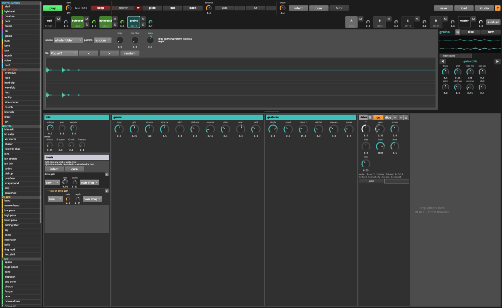
Flings little bits of your sample folder around. **source**: the whole folder, or *stick to one
file* (drag on the waveform to pick a region); **position** random or scanning like a tape head;
**stray** (chance of a grain from elsewhere), **hop** (chance per bar of jumping to a new file).
Device panel: busy, grid, size, pitch and their variation, reverse, click, and the gesture weights
(single, cloud, ratchet, smear).

### noise
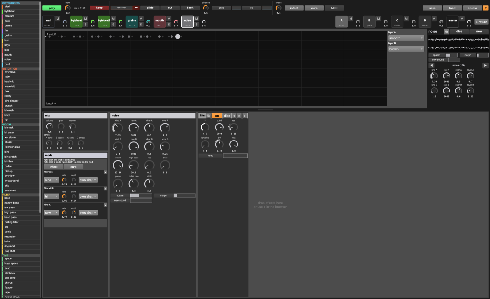
Two layers (A, B), each sweeping continuously through 20 kinds of noise: white, pink, brown, grey,
bits, stepped, clipped, smooth, velvet, dust, crackle, rain, wind, radio, metal, sine fm, logistic,
henon, cusp, gendy. Per layer: **kind** (menu, or the knob to morph between neighbours), **rate**,
**char**, **level**. Then **cutoff**, **high pass**, **res**, **drive**, **pulse** (gate) and
**pulse rate**, **width**. Keys set layer A's rate (pitched noise).

### mouth
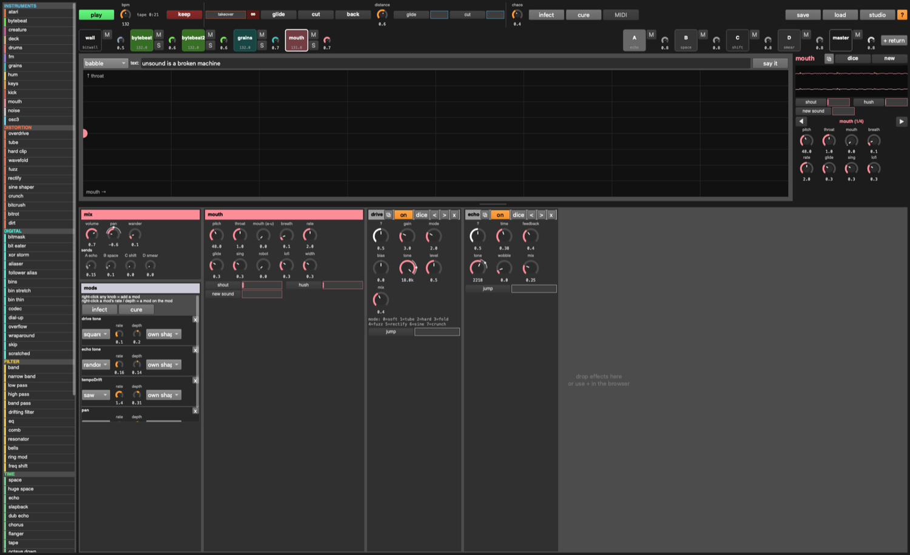
A talking machine. **babble** (random syllables), **say the text** (type into the box, it loops
it), **hold a vowel** (sweep a → e → i → o → u on the XY pad). **pitch**, **throat** (head size),
**mouth**, **breath**, **rate** (syllables per beat), **glide**, **sing** (0 = speech, 1 = sings
the scale), **robot** (monotone), **lofi** (down to Speak & Spell). Keys: a note sets the pitch
and says a syllable.

### deck
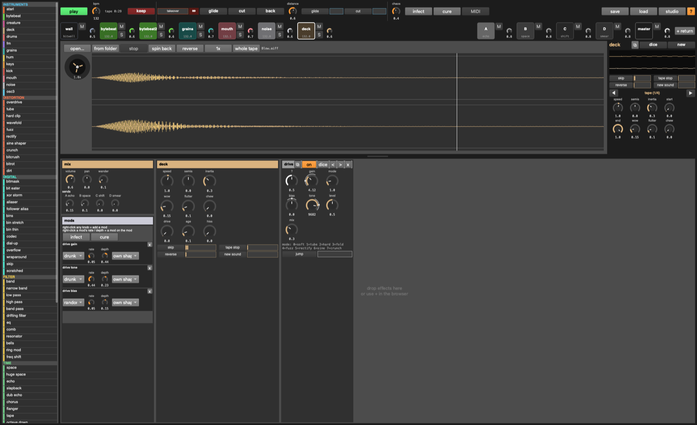
A tape player. **open…** any audio file, **from folder** for a random one. It loops the region
forever: **click** the waveform to move the playhead, **drag** to pick the loop, **whole tape**
to reset. **speed** −8× to 8× through a motor with **inertia** (so changes swoop), **semis**,
**stop**, **spin back**, **reverse**, **1x**. Wear: **wow**, **flutter**, **chew** (skips and
drop-outs), **drive**, **age**, **hiss**. The reel shows the motor.

### osc3
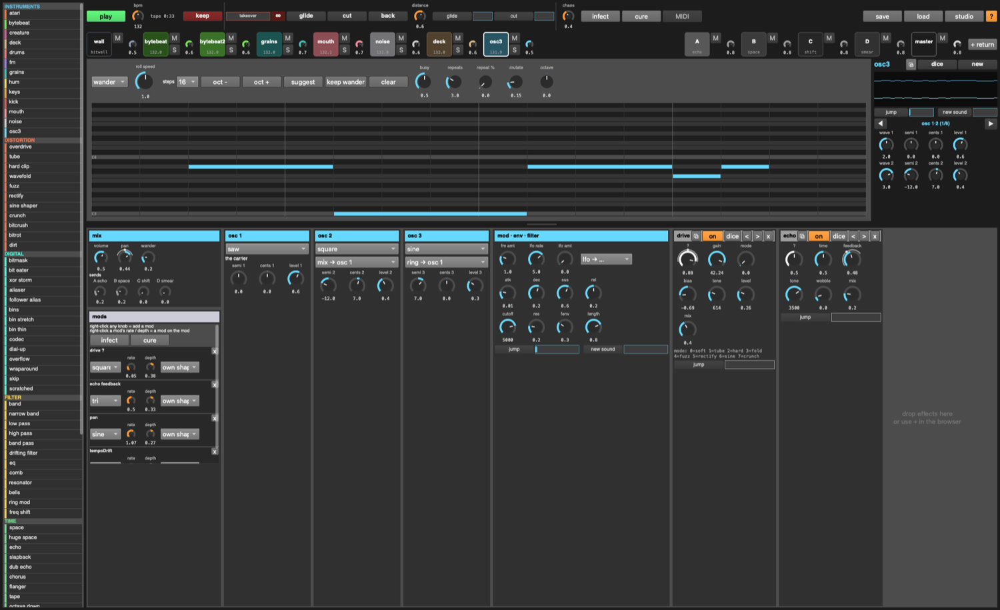
A 3xOsc. Three oscillators (sine / tri / saw / square / noise), each with semitones, cents and
level. Osc 2 and 3 each **mix**, **ring**, **fm** or **am** into osc 1 (**fm amt**). A pitch LFO
(**lfo rate**, **lfo amt**), envelope (**atk dec sus rel**), filter (**cutoff res fenv**). The
**lfo → …** menu puts a sine mod on any of its knobs in one click. Plays the piano roll or wanders.

### atari
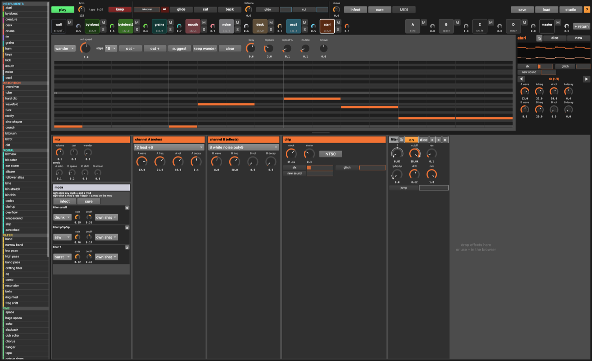
The Atari 2600's sound chip, emulated from its counters. Two channels, each with the real
registers: **wave** (AUDC, 16 waveforms: buzz, rumble, pure, bass, lead, white noise…), **freq**
(AUDF, 0–31), **vol** (AUDV, 0–15), **decay**. Channel A plays the roll / wander / keys (notes snap
to the nearest AUDF, so they're out of tune like the real thing); channel B does sound effects.
**clock** overclocks the chip (**NTSC** resets it).

### drums
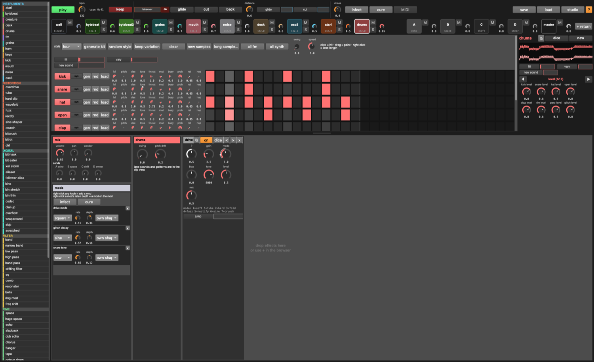
Eight lanes, each its own sequencer. **click** = hit, **drag** = paint, **right-click** a cell =
the lane ends there (polymeter). Per lane: **syn / fm / smp** (click to cycle the sound), **gen**
(new pattern), **rnd** (random sample slice), **load** (your own sample), and knobs for level,
pitch, decay, tone, fm ratio, mutate, busy, probability, ratchet, hop. Kit: **style**,
**generate kit**, **keep variation**, **new samples**, **long sample…** (one long file the whole
kit slices from, at its onsets), **all fm**, **all synth**. Solid = your hit, outline = mutation
added one, dot = mutation removed one.

### creature, hum
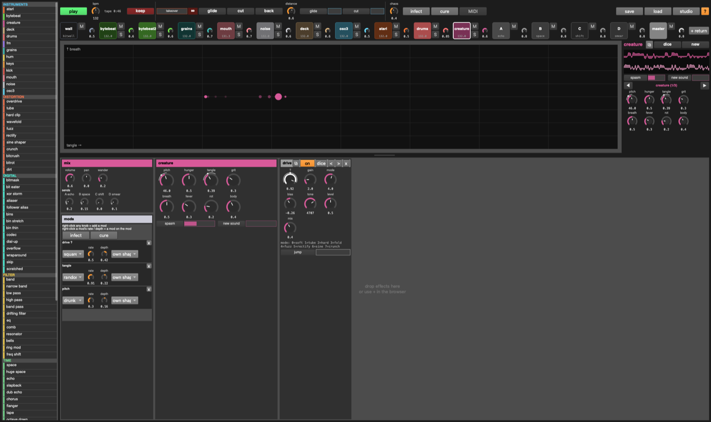
Continuous noise beasts. **creature**: chaotic oscillators tangled together (hunger, tangle, grit,
breath, fever, rot, body). **hum**: a self-oscillating feedback network (tension, size, tint,
unrest, swell). XY pad + knobs.

### keys, fm, kick
The older instruments. **keys**: a region of a sample played like a synth (shot or looped as an
oscillator). **fm**: drawable carrier / modulator waveforms. **kick**: a 16-step kick you draw.
keys and fm play a **piano roll** (click to add, drag to lengthen, click a note to delete;
**suggest**, **wander**, **keep wander**, repeats, mutate).

---

## 11. Effects

The browser's categories (hover each for a description):

- **distortion**: overdrive, tube, hard clip, wavefold, fuzz, rectify, sine shaper, crunch, bitcrush, bitrot, dirt
- **digital** (things a pedal can't do):
  - **bitmask**: the signal as 16-bit integers, XOR / AND / OR with a mask that sweeps by itself
  - **aliaser**: sample-and-hold with no filter; loud moments push the rate up (**follow**)
  - **bins**: stretch and shift the spectrum; **thin** throws bins away
  - **codec**: a bad stream: only spectral peaks survive (**quality**), frames **warble**, packets drop (**loss**)
  - **overflow**: integer wraparound: push it and loud turns into its opposite (**fold** reflects instead)
  - **skip**: a scratched CD, sticking on tiny chunks of the last two seconds
- **filter**: **band** (just lows and highs: drag the edges, drag the middle to move both, scroll =
  resonance), low / high / band pass, drifting filter, eq, **EQ Eight**, comb, resonator, bells,
  ring mod, freq shift
- **time**: space, echo, slapback, dub echo, chorus, flanger, tape, octave down / up, reverse, smear
- **glitch**: stutter, chop, freeze, scramble, blur, feedback, screamer
- **dynamics**: compressor, gate, width, autopan, limiter
- **chains**: noise wall, broken radio, tape ghost, metal, dissolve, digital rot, broken stream

**EQ Eight**: eight bands like Ableton's. Drag a dot (left/right = frequency, up/down = gain),
scroll on it = Q, double-click = on/off. Click a number below to pick a band: its **type** (low cut,
low shelf, bell, notch, high shelf, high cut), **on**, freq, gain, Q. The curve is the real response.

**stutter / freeze** have a **HOLD** pad; on the master, hold **B** / **V**.

---

## 12. The 8 encoders and MIDI

The 8 small knobs at the bottom of the focus column are the focused track's current **page**.
Pages are made automatically: the instrument's knobs, **mix**, then one per device. **◀ ▶** or
**tab / shift-tab** change page. They're mostly there for a MIDI controller:

- **MIDI** (top bar) = learn. Switch it on, touch something on screen, move a control on your
  controller. Done.
- Learning an **encoder** maps *the encoder*, not the knob under it, so 8 hardware knobs follow
  whatever track and page you focus.
- **◀ ▶** (pages), **glide**, **cut**, **back**, **keep**, **dice**, **new** can be learned onto
  pads or buttons.
- Any knob, slider or toggle anywhere can be learned directly too.
- Jog wheels (relative encoders) are detected and nudge instead of jump.
- **MIDI notes** play the focused track (GM drum notes work on drums).
- Mappings are saved with the set.

---

## 13. Playing it from the keyboard

| key | |
|---|---|
| **space** | play / stop |
| **A W S E D F T G Y H U J K O L P ;** | notes on the focused track (drums: one lane per white key) |
| **Z / X** | octave down / up |
| **, / .** | master tempo down / up (3%, no limits: at absurd tempos rhythm turns into pitch) |
| **1–9 / 0** | focus instrument track 1–9 / the master |
| **← / →** | previous / next track |
| **↑ / ↓** | volume (with **shift**: that track's tempo) |
| **tab / shift-tab** | next / previous encoder page (studio: clip → devices → mods) |
| **`** | box ↔ studio window |
| **return** | keep the tape (**shift**: last minute) |
| **'** (hold) | takeover: the focused track to infinity |
| **Q / = / -** | glide / cut / back |
| **/** | dice the focused track |
| **N** | new sound |
| **M** | mute the focused track |
| **R** | resync the focused track to the master clock |
| **I / \\** | infect / cure |
| **B / V** (hold) | stutter / freeze the master |
| **C** | capture a scene |
| **[ / ]** | previous / next scene |
| **?** | the shortcuts window |

The keyboard plays whenever the window is in front and you're not typing in a text box.

---

## 14. The studio window

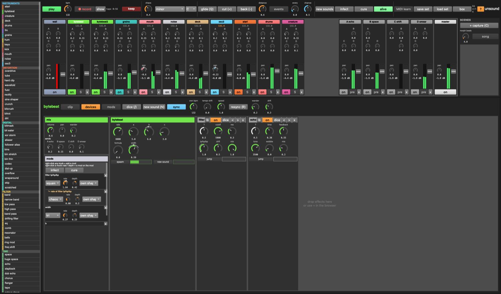

Press **`** or **studio**. The Ableton-shaped view, for when you want everything at once:

- **mixer**: one strip per track with sends to every return, pan, meter, fader, on / **S** / **x**
  (remove). Returns have **pre** (pre-fader sends) and can send to each other (feedback allowed).
  Scroll sideways with the wheel.
- **scenes** (right of the mixer): **+ capture (C)** snapshots everything; click a scene to launch
  it, morphing over **morph beats**; **↻** updates it, **x** deletes it. **song** plays the list of
  scenes (set from code, see below).
- **header** of the focused track: **clip / devices / mods** tabs, dice, new sound, and the tempo
  controls (sync, own bpm, tempo drift, speed, resync), wander, drift.
- **transport**: record (and **show** it in Finder), tape + keep, chaos, **scale** and **key**,
  glide / cut / back, **events** (every / chance), new sounds, infect / cure / **alive**, MIDI learn,
  save / load set, **box** (back to the box).
- **mods** tab: every mod in the set.

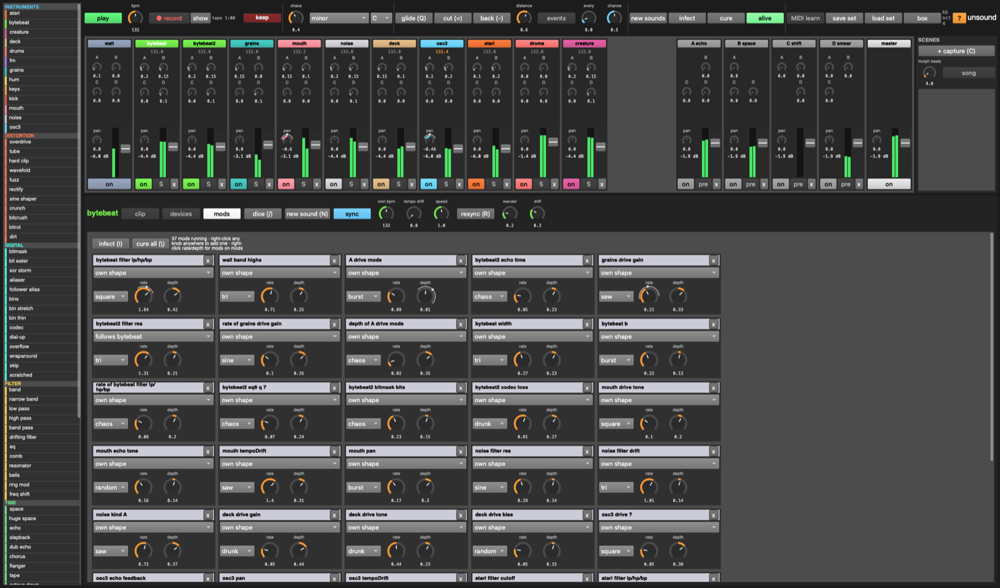

---

## 15. Sets, scenes, files

- **save / load** (top bar): a whole set (tracks, devices, sends, mods, scenes, song, MIDI maps,
  the wall, loaded files' paths) in one `.unsound` file. Sets go in `sets/` by default.
- **keeps** and recordings go to `~/Music/unsound/`.
- The sample folder is `~folder` in `play.scd`; `~reload.("~/some/folder")` swaps it while playing.

---

## 16. From code (`play.scd`)

Everything in the window can be done from code. A few favourites:

```
~add.(\mouth);                         // a new track
~dev.(\bytebeat, \overflow);           // an effect on a track
~tset.(\mouth, \text, "hello");        // any track setting
~send.(\grains, \A, 0.6);              // a send
~ramp.(\bytebeat, \rate, 20000, 16);   // glide a setting over 16 beats
~wallPick.(5);                         // the scream wall
~takeover.(\bytebeat2, 1);             // takeover from code
~keep.(120);                           // keep the last two minutes
~song = List[[0, 16], [1, 8]]; ~playSong.();   // scenes in order: [scene, bars]
```

**Make your own**:
- a **noise kind**: one line in `~noiseKinds` (`lib/voices/noisegen.scd`): `["name", { |rate, char| signal }]`
- a **wall**: one line in `~wallTypes` (`lib/wall.scd`): `["name", { |dens, grit, motion| stereo signal }]`
- an **effect**: a `~deviceDef` and an entry in `~deviceTypes` (`lib/devices.scd`), plus a
  description in `lib/descriptions.scd`
- an **instrument**: a file in `lib/voices/` registering `~voiceTypes[\name]` (copy one), added to
  the list in `unsound.scd`

---

## 17. When something's wrong

- **Silence**: is **play** on? Is the track muted (**M**), or something else soloed (**S**)? Is the
  wall faded out? Cmd-. and play again.
- **Way too loud**: the master's limiter catches it; pull the master pad's volume down, or turn the
  takeover slider back to empty.
- **The server won't boot**: the input and output sample rates differ (e.g. AirPods mic). unsound
  starts without inputs to avoid that; if it still fails, pick one output device in Audio MIDI Setup.
- **Memory**: the tape keeps 15 minutes in RAM (about 350 MB). Set `~tapeMinutes = 5` before loading
  to use less.
- **A knob won't stay where I put it**: it has a mod. Right-click it to take the mod away, or turn
  its depth down in the mods panel.
